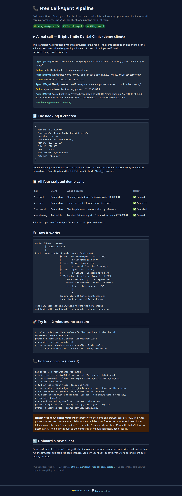
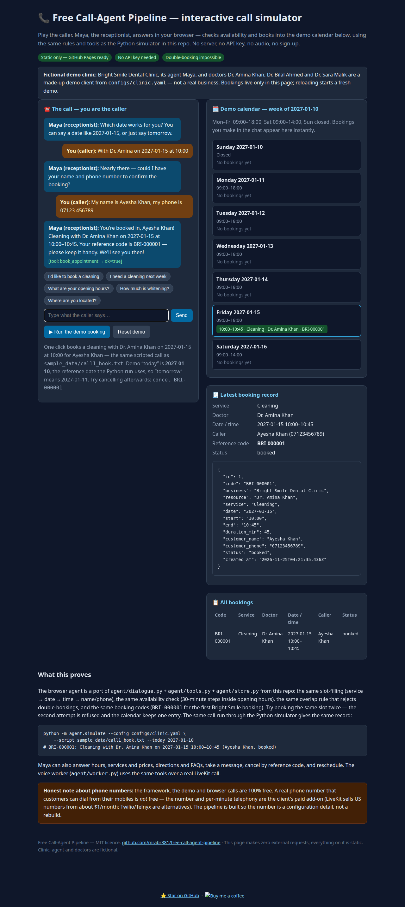
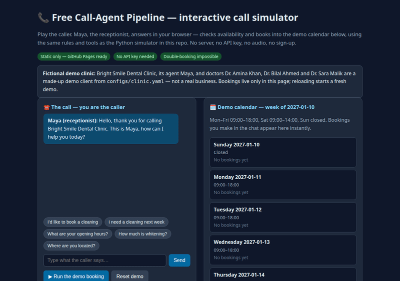

# Free Call-Agent Pipeline

[](https://github.com/mrabr381/free-call-agent-pipeline/actions/workflows/ci.yml)


[](https://github.com/mrabr381/free-call-agent-pipeline) [](https://www.buymeacoffee.com/muhammadabubakar)

**A free phone receptionist for small businesses — it answers calls, books appointments and takes messages, with no platform fees and no per-minute bill.**

One YAML per client, one pipeline for all of them. A new client means a new config file, not new code.

## Live demo

**[▶ Try the interactive call simulator — play the caller, book a cleaning with Dr. Amina, and watch the demo calendar fill](https://mrabr381.github.io/free-call-agent-pipeline/demo/)**

Or see the scripted version: **[a real scripted call — booking a dental cleaning, with the booking record it created](https://mrabr381.github.io/free-call-agent-pipeline/sample_output/)**


*The scripted version — the full call transcript, the booking record it created (code **BRI-000001**), and all four scripted demo calls.*


*The live demo in use — the chat with Maya books a cleaning with Dr. Amina Khan on 2027-01-15 at 10:00, reference **BRI-000001**, and the booking appears on the demo calendar, in the booking record and in the bookings table.*


*The demo in motion — the booking chat with Maya, from "I'd like to book a cleaning" to the confirmed booking BRI-000001.*

> ✅ **Live on GitHub Pages:** both links above are live — the interactive call simulator and the scripted-call report.

Or run the call yourself — no account, no key, no audio (see [Quickstart](#quickstart)):

| Call | Client | What it proves |
|---|---|---|
| 1 — book | Dental clinic | Cleaning booked with Dr. Amina, code `BRI-000001` |
| 2 — info | Dental clinic | Hours, prices (£150 whitening), directions |
| 3 — cancel | Dental clinic | Check-up booked, then cancelled by reference |
| 4 — viewing | Real estate | Two-bed flat viewing with Emma Wilson, code `CIT-000001` |

Run all four at once (and regenerate `sample_output/`): `bash scripts/run_simulations.sh`

## Quickstart

```
git clone https://github.com/mrabr381/free-call-agent-pipeline.git
cd free-call-agent-pipeline
python3 -m venv .venv && source .venv/bin/activate   # Windows: .venv\Scripts\activate
pip install -r requirements.txt
python -m agent.simulate --config configs/clinic.yaml --script sample_data/call1_book.txt --today 2027-01-10
python -m agent.simulate --config configs/clinic.yaml   # interactive — type caller lines yourself
python -m unittest discover -s tests                    # run the tests
```

## What it does

- **Answers like a receptionist** — greeting, hours, services and prices, directions, FAQs, taking messages for a human.
- **Books real appointments** — availability checks, booking with a confirmation code, cancel, reschedule. Double-booking is impossible by design (overlap check *and* a partial UNIQUE index on booked rows in SQLite).
- **One config per client** — business name, agent persona, hours, services with prices and durations, staff, FAQs. Copy a YAML, change the details, done. Two are shipped: a dental clinic and an estate agency. Both are fictional — this is a template, so use your own client's real details.
- **Free local voice stack** — faster-whisper STT, Ollama LLM, Piper TTS, Silero VAD — all on your machine, no per-minute bill. Cloud providers (Deepgram, Gemini) are optional, bring-your-own-key.
- **Testable without a phone** — the text simulator runs the exact same dialogue engine and tools as the voice worker, so every call flow is verified before it ever takes a live call.

## Before / after

**Before:** $0.05–$0.10 per minute on a hosted voice-agent platform, per-minute STT + LLM + TTS on top, a new build (or a new monthly seat) for every client — and the client still pays every month, forever.

**After — the same receptionist, on this pipeline:**

```
Agent: Hello, thank you for calling Bright Smile Dental Clinic. This is Maya, how can I help you today?
Caller: Hi, I'd like to book a cleaning appointment
Caller: With Dr. Amina on 2027-01-15 at 10:00
Caller: My name is Ayesha Khan, my phone is 07123 456789
Agent: You're booked in, Ayesha Khan! Cleaning with Dr. Amina Khan on
       2027-01-15 at 10:00–10:45. Your reference code is BRI-000001.
```

The demo runs with **zero keys, zero accounts, zero audio** — and the voice path runs on local models that cost nothing per minute.

## How it works

```
Caller (phone / browser) ──▶ LiveKit room ──▶ Agent worker (agent/worker.py)
  ├─ STT: faster-whisper (local, free) or Deepgram (BYO key)
  ├─ LLM: Ollama (local, free) or Gemini free tier (BYO key)
  ├─ TTS: Piper (local, free) or Gemini / Deepgram (BYO key)
  └─ Tools (agent/tools.py): availability, booking, cancel/reschedule,
     hours, services, directions, messages ──▶ Booking store (SQLite)
Text simulator (agent/simulate.py) runs the SAME engine and tools
with typed input — no accounts, no keys, no audio.
```

## Onboard a new client

1. Copy `configs/clinic.yaml` to `configs/<client>.yaml` and change the business, agent, hours, services, staff and FAQs.
2. Validate it with the simulator — a bad config fails fast with a plain-English error (missing section, bad `HH:MM` hours, duplicate service, negative price); see `tests/test_config.py`.
3. Point the worker at it: `python -m agent.worker --config configs/<client>.yaml`.

No code changes. Ever — if a client needs something the tools don't cover, that is a feature request for the pipeline, not a per-client fork.

## Go live on voice

```bash
pip install -r requirements.txt -r requirements-voice.txt
# 1. LiveKit: free LiveKit Cloud project (Build plan: 1,000 agent minutes/month
#    included); export LIVEKIT_URL, LIVEKIT_API_KEY, LIVEKIT_API_SECRET.
# 2. Piper voice (free, one-time download):
python -m piper.download_voices en_US-lessac-medium --download-dir voices/
export PIPER_VOICE="$PWD/voices/en_US-lessac-medium.onnx"
# 3. Local LLM (or --llm gemini with a free Google AI Studio key): ollama pull llama3.1
# 4. Check everything resolves, then start the worker:
python -m agent.worker --config configs/clinic.yaml --dry-run
python -m agent.worker --config configs/clinic.yaml
```

Flags: `--stt whisper-local|deepgram`, `--llm ollama|gemini|openai`, `--tts piper|gemini|deepgram`. Every provider degrades with a clear message when its key, model or voice file is missing — the worker never crashes with a bare traceback and never silently fakes a reply.

## Phone numbers (the one paid part)

The framework, the demo and browser calls are 100% free. A real phone number customers can dial is **not** free — the number and per-minute telephony are the client's paid add-on (LiveKit sells US numbers from about $1/month; Twilio/Telnyx are alternatives, via SIP trunk). The pipeline treats the number as configuration, not a rebuild.

## Tools the agent can call

`check_availability` · `book_appointment` · `cancel_appointment` · `reschedule_appointment` · `get_hours` · `get_services_and_prices` · `get_directions` · `take_message` — availability, booking with a confirmation code, cancel/reschedule, hours, prices, directions, and messages for a human callback.

## Tests

```bash
python -m unittest discover -s tests -v
```

43 tests, all passing (verified 2026-11-20): **Store (13)** — double-booking and overlap rejected, adjacent slots allowed, past dates rejected, cancel frees the slot, reschedule rules; **Config (12)** — both shipped configs load, bad configs fail with a clear message; **Dialogue (8)** — all four scripted calls end-to-end, hand-checked; **Worker (6)** — instructions from config, missing-key errors, exactly 8 tools; **Voice adapters (4)** — Piper missing-voice error, Whisper adapter builds, **Piper → faster-whisper round-trip** (synthesised speech transcribed back word-for-word), Piper emits real audio frames. Round-trip tests run only when `PIPER_VOICE` points at a voice file. CI runs the same suite on every push/PR to `main` (`.github/workflows/ci.yml`).

## Honest limitations

- **Voice path verified without a live room** — worker, providers, adapters and tools are constructed and exercised in the sandbox (dry-run, round-trip, 43 tests), but no live LiveKit call was placed; a first real call needs your LiveKit credentials and one test call. **No live Gemini/Ollama call tested in the sandbox** — construction verified only; live generation needs Ollama running, Gemini needs your own free key.
- **No real phone number included** — telephony is the client's paid add-on (see above). **No HIPAA/compliance claim** — clinics handling health data must check their own obligations (retention, consent, data residency) before going live.
- **Local models are good, not magic** — tiny Whisper is fast but less accurate on accents/noise than cloud STT (use `base` or Deepgram for production); Piper voices are clear but single-voice, not ElevenLabs. **TTS quality was not listening-tested** — proven by numbers (Piper emits real 22,050 Hz PCM; faster-whisper transcribes it back word-for-word), not by a human ear. Listen to one call before selling it to a client.
- **faster-whisper + PyAV quirk (fixed in code)** — faster-whisper 1.2.1 decodes audio via PyAV, incompatible with the av≥14 that livekit-agents 1.8 requires; the `WhisperSTT` adapter decodes audio itself and passes a float32 numpy array, never a file path. Do not "fix" this by downgrading `av`.
- **The simulator is rule-based, not an LLM** — keyword intent matching, so calls are deterministic and testable. The voice worker uses a real LLM; replies vary, but every booking goes through the same tested tools.

## Project structure

```
free-call-agent-pipeline/
├── README.md, LICENSE (MIT), .gitignore, assets/hero.svg
├── requirements.txt / requirements-voice.txt   # core: PyYAML only; voice: livekit-agents, faster-whisper, piper-tts
├── .github/workflows/ci.yml    # CI: install + run the 43 tests
├── agent/                      # config, store, tools, dialogue, simulate, worker, voice adapters
├── configs/                    # clinic.yaml (fictional), real-estate.yaml (fictional)
├── sample_data/ + sample_output/   # 4 scripted calls; demo page + real transcripts + booking record
├── scripts/run_simulations.sh  # regenerates sample_output/
└── tests/                      # 43 tests (unittest, stdlib)
```

## License

MIT — see [LICENSE](LICENSE).
